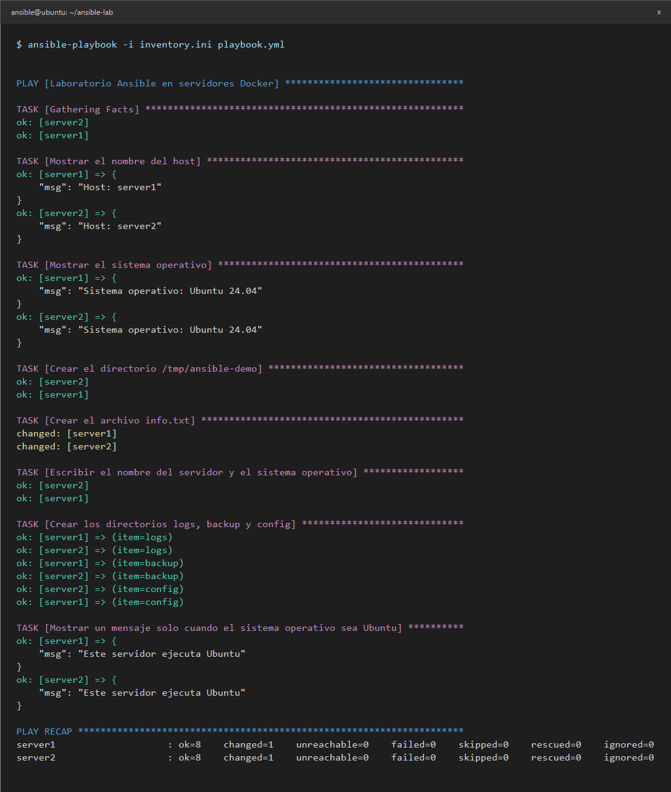

# Laboratorio de Ansible con servidores Linux en Docker

## Objetivo

Crear un laboratorio con dos servidores Linux (`server1` y `server2`) usando Docker y administrarlos de forma centralizada con Ansible. El playbook muestra información de cada servidor, crea un directorio de trabajo, genera un archivo con los datos del host y su sistema operativo, crea directorios mediante un loop y muestra un mensaje condicional para Ubuntu.

## Estructura del proyecto

```text
ansible-lab/
├── docker-compose.yml
├── inventory.ini
├── playbook.yml
├── screenshot.png
└── README.md
```

## Requisitos

- Docker con Docker Compose.
- Ansible instalado en el equipo de control.
- Si usas Windows, ejecuta Ansible desde WSL (Ubuntu) con la integración de Docker Desktop habilitada.

## 1. Iniciar los contenedores

Desde la carpeta `ansible-lab`:

```bash
docker compose up -d
```

Verificar que ambos servidores estén ejecutándose:

```bash
docker ps
```

## 2. Instalar Python en los contenedores

Ansible requiere Python en los hosts administrados:

```bash
docker exec server1 bash -c "apt update && apt install -y python3"
docker exec server2 bash -c "apt update && apt install -y python3"
```

## 3. Inventario

El archivo `inventory.ini` contiene:

```ini
[docker]
server1 ansible_connection=docker ansible_python_interpreter=/usr/bin/python3
server2 ansible_connection=docker ansible_python_interpreter=/usr/bin/python3
```

Comprobar la conexión con Ansible:

```bash
ansible docker -i inventory.ini -m ping
```

Resultado esperado: `SUCCESS` para `server1` y `server2`.

## 4. Ejecutar el playbook

```bash
ansible-playbook -i inventory.ini playbook.yml
```

El playbook realiza las siguientes tareas en ambos servidores:

1. Muestra el nombre del host.
2. Muestra el sistema operativo.
3. Crea el directorio `/tmp/ansible-demo`.
4. Crea el archivo `info.txt`.
5. Escribe el nombre del servidor y el sistema operativo.
6. Crea los directorios `logs`, `backup` y `config` mediante un loop.
7. Muestra un mensaje únicamente cuando el sistema operativo es Ubuntu.

## 5. Verificar el resultado

```bash
docker exec server1 cat /tmp/ansible-demo/info.txt
docker exec server2 cat /tmp/ansible-demo/info.txt

docker exec server1 ls -l /tmp/ansible-demo
docker exec server2 ls -l /tmp/ansible-demo
```

Contenido esperado de `info.txt`:

```text
Servidor: server1
Sistema operativo: Ubuntu 24.04
```

## Captura de la ejecución exitosa



## Detener el laboratorio

```bash
docker compose down
```
